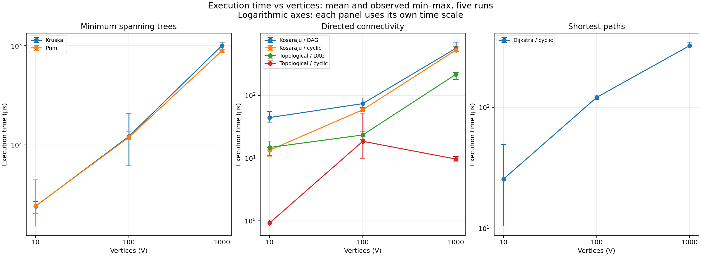
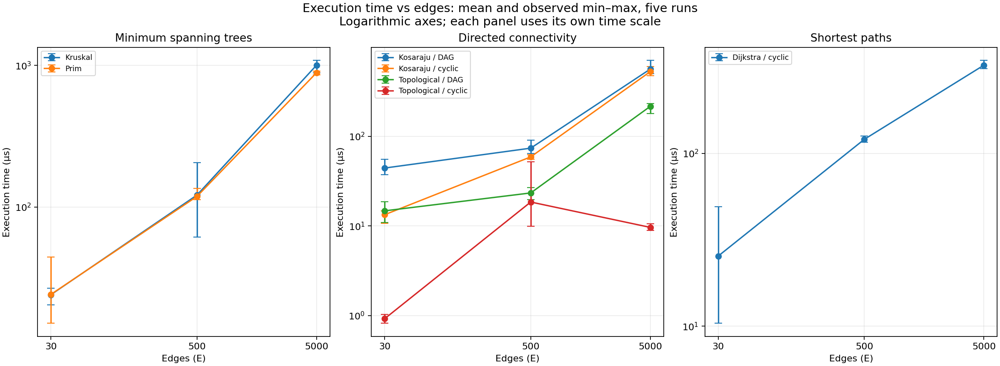

# Smart City Infrastructure and Route Planning

Java implementation and experimental analysis of graph algorithms for Assignment 3.

## Overview

The city is a weighted graph: vertices represent districts and edges represent roads or infrastructure connections. Edge weights represent construction costs for infrastructure planning or distances for route planning.

The assignment has three tasks:

1. Minimum spanning trees using Kruskal, Prim, and a disjoint set union structure.
2. Directed connectivity using topological ordering and strongly connected components.
3. Shortest paths using Dijkstra's algorithm.

## Build and run

Requirements: a **JDK 17 or newer** and **Bash**. There are no external Java dependencies; Maven and Gradle are not required.

From the repository root:

```bash
bash scripts/build.sh
bash scripts/run.sh
bash scripts/test.sh
bash scripts/benchmark.sh
```

The demo prints a four-district undirected network, then uses Kruskal to select roads with a minimum total construction cost of **17**. It reports connectivity and component count, runs Prim on the same network, and checks that both MST weights agree. It also orders directed service dependencies, detects a cycle after adding a back edge, and reports three strongly connected groups: `{0}`, `{1}`, and `{2, 3, 4}`. Group/member order is not significant. A separate route network demonstrates Dijkstra from district 0: distances to districts 0–3 are **0, 3, 2, 6**, and district 4 is unreachable. Both distances and actual paths are printed. Compiled classes are written to the ignored `build/` directory.

## Implementation

The graph representation, disjoint set union structure, Kruskal, Prim, topological ordering, Kosaraju SCC, and Dijkstra are implemented. Reproducible benchmark measurements, plots, and analysis are included below.

```text
src/
  Main.java
  graph/          Weighted graph and edge representation
  dsu/            Disjoint sets with path compression and union by size
  mst/            Kruskal, Prim, and immutable MST results
  connectivity/   Kahn topological ordering and Kosaraju SCC
  shortestpath/   Dijkstra distances and path reconstruction
  benchmark/      Reproducible graph generation, validation, and CSV exports
  metrics/        Optional per-invocation operation counters
tests/            Java assertion-based correctness tests
scripts/          Build, run, test, benchmark, and plotting commands
results/
  tables/         Raw timings, summaries, operation counts, and environment
  plots/          Execution-time plots in PNG and SVG
```

`WeightedGraph` stores an adjacency list and a list of logical edges. Vertices use consecutive IDs from `0` to `V - 1`. The constructor selects directed or undirected behavior. For an undirected road, both endpoints have an outgoing adjacency entry, while `edges()` lists that road once so that Kruskal will not process it twice. A self-loop is stored once in its vertex's adjacency list. Parallel edges and duplicate weights are preserved.

`Edge` is an immutable Java record with integer endpoints and weight. The graph accepts any integer weight, since negative weights can be valid for MST algorithms; Dijkstra enforces its own non-negative-weight requirement. Invalid vertex IDs are rejected before any change to the graph. Read methods expose unmodifiable live views, so callers can traverse connections without bypassing graph validation.

`DisjointSetUnion` maintains a partition of element IDs from `0` to `V - 1` using parent and component-size arrays. Initially each element is its own component. `find` first walks to the root and then redirects every visited element directly to that root (path compression). Both passes are iterative, so no recursion stack is needed. `union` attaches the smaller component's root to the larger component's root, updates its size, and decreases the component count. It returns `true` only when two different components were merged; repeated or self unions return `false`. Kruskal uses this result to reject edges whose endpoints are already connected.

The DSU also provides `connected`, `componentSize`, and `componentCount`. Representatives identify components and may change after a union; their numeric IDs do not indicate component size or ordering. Negative element counts and out-of-range element IDs are rejected. An empty DSU has zero components, and a single element starts in a component of size one.

`Kruskal.compute(graph)` copies the logical edge list, sorts it by ascending weight, and accepts an edge only when DSU can merge its endpoint components. This avoids cycles and naturally excludes self-loops. Once the graph has one component, the algorithm can stop. The input graph and its edge order are preserved. Directed graphs are rejected; parallel edges, duplicate weights, and negative weights are supported. Weight comparisons avoid integer subtraction, and the total is accumulated in a `long` so that sums of integer edge weights do not overflow an `int`.

`MstResult` contains an immutable snapshot of the selected edges, their total weight, and the remaining component count. For a connected graph, this is an MST with `V - 1` edges. For a disconnected graph, it is a minimum spanning forest with `V - C` edges, where `C` is the component count, and `connected()` returns `false`. A single vertex is connected with zero edges and cost zero. An empty graph has zero components, zero cost, and `connected() == false` by this implementation's convention. Different MSTs can contain different edges when weights tie; their minimum total weight is the quantity to compare.

`Prim.compute(graph)` grows a tree from an unvisited vertex using a binary-heap priority queue of frontier edges. Each visit marks its vertex and adds outgoing edges to unvisited neighbors. The cheapest queued edge extends the tree unless its destination has already been visited; such stale entries are discarded. When the queue empties, the algorithm restarts at another unvisited vertex, so disconnected graphs include every component and isolated vertex. It returns the same `MstResult` type and follows the same input and empty-graph conventions as Kruskal. Selected undirected edges may use the reverse orientation of the original logical edge.

`TopologicalSort.compute(graph)` implements Kahn's algorithm for directed graphs. It counts incoming edges, queues all zero-indegree vertices, and removes each queued vertex while decrementing its outgoing neighbors' indegrees. If every vertex is processed, `TopologicalResult` contains a complete immutable order with `acyclic() == true`. Otherwise the graph has a cycle and the result has `acyclic() == false` and an empty order, so a processable prefix cannot be mistaken for a complete answer. Disconnected DAGs include all isolated vertices. Empty directed graphs have a valid empty order, duplicate edges are counted individually, and edge weights do not affect ordering. Undirected input is rejected.

`Kosaraju.compute(graph)` finds every strongly connected component of a directed graph. The first depth-first pass records each vertex after all its outgoing edges have been examined. The algorithm then builds a transpose by reversing every edge and starts traversals there in decreasing finishing order. Each second-pass traversal collects exactly one SCC. Both passes use explicit stacks, including saved edge iterators for first-pass finishing order, avoiding dependence on the Java call-stack depth.

`SccResult` holds an immutable outer list of components and an immutable list of members for each component. Every vertex belongs to exactly one component, including isolated vertices; an empty directed graph has no components. Edge weights do not affect reachability, and duplicate edges or self-loops are supported. Undirected input is rejected. Component order and member order are traversal details rather than a ranking of districts. Vertices share an SCC only when each can reach the other; a one-way road between two SCCs does not merge them.

`Dijkstra.compute(graph, source)` finds shortest distances from one source on either directed or undirected graphs. A binary-heap priority queue stores tentative `(vertex, distance)` states. Strictly shorter routes update the distance and predecessor and insert a new queue state; outdated states are discarded when removed. Strict improvement also prevents predecessor cycles when zero-weight cycles exist. All edges are checked for negative weights before the search, including edges unreachable from the source. An invalid source is rejected; an empty graph has no valid source. Distances use `long` so that paths whose total exceeds the integer range are represented correctly.

`ShortestPathResult` snapshots its distance and predecessor arrays. `distanceTo(v)` returns the shortest distance or `UNREACHABLE` (`Long.MAX_VALUE`); `reachable(v)` distinguishes the two cases. `pathTo(v)` reconstructs an immutable source-to-destination vertex list iteratively, returns an empty list for an unreachable vertex, and returns `[source]` for the source itself. The original graph is preserved, and later graph updates do not change an existing result. Equal-distance alternatives may return different valid shortest paths.

Dijkstra's greedy finalization requires non-negative edge weights: when the smallest tentative distance is removed from the queue, any alternative route through an unprocessed vertex cannot reduce it. A negative edge breaks that argument. For example, edges `s -> a` of weight 2, `s -> b` of weight 5, and `b -> a` of weight -4 give an actual shortest distance of 1 to `a`, although greedy finalization would accept 2 first. This implementation rejects negative weights rather than treating its queue behavior on such inputs as a valid Dijkstra guarantee; algorithms such as Bellman–Ford are appropriate when negative edges must be supported, with negative-cycle handling.

## Complexity Analysis

The adjacency list plus logical edge list uses **O(V + E)** space, including the reverse entries for undirected edges. Graph construction takes **O(V)** before edges are added. Adding an edge takes amortized **O(1)**; enumerating neighbors of vertex `v` takes **O(out-degree(v))**; enumerating all logical edges takes **O(E)**. Retrieving a read-only view or a vertex/edge count takes **O(1)**.

For DSU, let **V** be the number of elements:

| Operation | Time complexity |
| --- | --- |
| Construction | O(V) |
| `find`, `union` | O(α(V)) amortized per operation; O(log V) worst case for an individual operation |
| `connected`, `componentSize` | O(α(V)) amortized, since they call `find` |
| `componentCount` | O(1) |

Here **α(V)** is the inverse Ackermann function, which grows extremely slowly. Union by size alone bounds the tree height by O(log V): an element's depth can increase only when its component is attached to one at least as large, so that component's size at least doubles. Path compression flattens the visited path, making later searches cheaper. Together the optimizations give O(V + m α(V)) total time for initialization followed by **m** find/union operations. The two arrays use **O(V)** total space, with **O(1)** additional space per operation.

Kruskal copies and sorts **E** logical edges, initializes DSU for **V** vertices, and makes at most **E** union attempts. Its time is **O(V + E log(E + 1) + E α(V))**, including DSU initialization, sorting, and edge processing. For a connected graph with at least two vertices, this is usually written as **O(E log E)**. The full expression also accounts for graphs with many isolated vertices or no edges. Increasing E adds sorting and union work; increasing V adds DSU initialization and storage. The copied edge list, sort workspace, DSU arrays, and selected edges require **O(V + E)** additional space beyond the input graph.

This implementation uses **lazy edge-based Prim**, without decrease-key: at most E logical edges enter the queue, and all adjacency entries are examined once. Its time is **O(V + E log(E + 1))** and additional space is **O(V + E)**, including the visited array, selected edges, and a queue that can hold O(E) entries. For connected simple graphs this is commonly written as O(E log V), since E is at most quadratic in V. The E-based bound also describes graphs with parallel edges. Larger E increases heap work and memory; larger V increases visited-array initialization and the scan for new components.

Topological ordering takes **O(V + E)** time and **O(V)** additional space with adjacency lists and an array-backed FIFO queue. Counting indegrees and scanning outgoing edges each take O(E); initialization, queue operations, and result construction take O(V). Both DAG and cyclic inputs have the same worst-case bound; a cycle may leave part of the graph unprocessed, but all incoming edges are still counted. Increasing either vertices or edges increases the work linearly.

Kosaraju takes **O(V + E)** time and **O(V + E)** additional space with adjacency lists. Each DFS pass visits every vertex and examines its outgoing edges once, and building the transpose also takes O(V + E). The transpose stores V adjacency lists and E reversed edges. Visited arrays, finishing order, explicit DFS stacks, and the output partition use O(V) space. More edges increase traversal work and transpose storage linearly; more vertices increase all vertex-indexed structures and the number of DFS starts in disconnected graphs.

Dijkstra's implementation uses lazy queue insertion rather than decrease-key. It validates all E logical edges, initializes V distance/predecessor entries, and scans the outgoing edges of each reachable vertex once when its current shortest state is removed. There are at most O(E) successful relaxations and O(E + 1) queued states. Its total time is **O(V + E log(E + 1))** and additional space is **O(V + E)**, including the lazy heap and result snapshot. On simple graphs, the heap term can also be written using log(V + 1), since E is at most quadratic in V. More vertices increase array initialization and result storage; more edges increase validation, relaxation, and heap work. `distanceTo` and `reachable` take O(1); reconstructing a path of k vertices takes **O(k)** time and space. Reconstructing paths is separate from the shortest-distance search.

## Experimental Setup

Run `bash scripts/benchmark.sh` to regenerate the checked-in tables, or pass another output directory to preserve them, for example `bash scripts/benchmark.sh /tmp/assignment3-results`. The runner uses these exact configurations:

| Graph | Vertices | Edges |
| --- | ---: | ---: |
| Small | 10 | 30 |
| Medium | 100 | 500 |
| Large | 1,000 | 5,000 |

The base seed is **20261029**; each configuration uses `base_seed + V`. `java.util.Random` generates integer weights from **1 to 100**. Self-loops and duplicate endpoint pairs are excluded from benchmark inputs; equal weights remain possible. Endpoint pairs are canonicalized for undirected graphs, while opposite directed edges are distinct. Additional edges use rejection sampling until the exact edge count is reached; impossible edge counts are rejected before generation.

- **Connected undirected:** shuffle the vertices, connect each vertex after the first to a randomly chosen earlier vertex, then add unique random roads. The initial spanning tree guarantees connectivity. Kruskal and Prim receive the same graph.
- **DAG:** shuffle a hidden vertex order and add edges only from earlier to later positions. This guarantees acyclicity without relying on numeric vertex IDs.
- **Cyclic directed:** insert `0 -> 1 -> 2 -> 0`, then add unique random directed edges. A cycle is guaranteed; other SCCs and unreachable vertices may also exist. Dijkstra uses this graph with source **0**.

There are **21 cases**: seven algorithm/input combinations at each size (Kruskal and Prim on undirected input, Kosaraju and topological ordering on both directed types, and Dijkstra on cyclic directed input). Each case has **100 untimed warm-up invocations**, followed by **five measured invocations** using `System.nanoTime()`. Algorithms allocate fresh mutable state on every invocation. Returned results escape through a volatile reference and are validated outside the timer. Graph generation, reference solutions, fingerprints, validation, console output, and file writing are excluded. Required algorithm work such as Kruskal's edge copying/sorting and Kosaraju's transpose construction is included. Dijkstra measures the distance/predecessor search; path reconstruction is excluded.

After all five timed invocations of a case, five separate **untimed instrumented invocations** collect operation counts. Both paths share the same implementation; ordinary calls pass no counter object. Counted and timed results must agree, and counts must be identical across the five repetitions. Optional counter checks remain in the common implementation, so this is not a claim of a completely instrumentation-free codebase.

Each timed and counted result is checked: MSTs must agree in weight, use real roads, span the graph, and contain no cycle; DAG orders must respect every edge; cyclic orders must be rejected. SCCs are checked against an independent all-source breadth-first mutual-reachability reference, including exact partition membership. Dijkstra distances are checked against an independent repeated-relaxation reference. Reference work is excluded from timing.

Counter definitions are intentionally specific:

| CSV counter | What is counted |
| --- | --- |
| `edge_examinations` | Kruskal's sorted-edge scan; Prim's adjacency entries; topological indegree and processed-adjacency scans; Kosaraju's first pass, transpose build, and second pass; Dijkstra's negative-weight validation and reached adjacency entries. |
| `key_comparisons` | Comparator calls in edge sorting or a binary heap, including tentative-distance comparisons in Dijkstra's heap. Ordinary branch comparisons are not included. |
| `find_calls`, `union_calls` | DSU calls during algorithm execution, including the two finds inside each union. |
| `parent_traversals` | Parent links followed in both passes of `find`. |
| `parent_writes` | Assignments during union/path compression, including assignments that leave a parent unchanged; constructor initialization is excluded. |
| `frontier_adds`, `frontier_removes` | Heap, FIFO queue, or explicit DFS-stack insertions/removals. Kosaraju includes both passes. |
| `relaxation_attempts`, `successful_relaxations` | Dijkstra's reached outgoing edges considered and the subset producing strict distance improvements. |

Zero means the defined event did not occur or is not used by that algorithm. Counts from different algorithms do not represent identical units of total work; for example, an undirected edge has two adjacency entries. All counters include only the algorithm invocation, not validation.

The checked-in run used **OpenJDK 17.0.20.1**, **Linux amd64**, an **AMD Ryzen 7 5800H**, and a JVM heap fixed at **256 MiB** (`-Xms256m -Xmx256m`). Full runtime metadata is in [environment.properties](results/tables/environment.properties). SHA-256 fingerprints include vertex/edge counts, direction, and the ordered endpoint/weight triples. Graphs, result signatures, and counters reproduce with the same code/runtime; elapsed times depend on the machine and runtime conditions.

## Results

The run contains **105 measured observations** (21 cases × five repetitions), plus separate counter invocations. [Raw observations](results/tables/benchmark_runs.csv) record each elapsed time, result signature, graph fingerprint, and counters. [Summary statistics](results/tables/benchmark_summary.csv) contain average, minimum, median, maximum, population standard deviation, and per-invocation counters. Counters were identical across all five repetitions of each case. A separate full rerun to a temporary directory reproduced every fingerprint, result signature, and operation count; its different timings are not substituted into the checked-in run.

Mean execution time in **microseconds** (the CSV files retain nanoseconds):

| Algorithm / input | V=10, E=30 | V=100, E=500 | V=1,000, E=5,000 |
| --- | ---: | ---: | ---: |
| Kruskal / connected undirected | 24.01 | 121.38 | 1003.12 |
| Prim / connected undirected | 24.13 | 118.76 | 887.50 |
| Kosaraju / DAG | 44.38 | 74.02 | 564.61 |
| Topological ordering / DAG | 14.78 | 23.42 | 216.70 |
| Kosaraju / cyclic directed | 13.38 | 59.13 | 529.10 |
| Topological ordering / cyclic directed | 0.92 | 18.54 | 9.66 |
| Dijkstra / cyclic directed | 25.46 | 120.62 | 323.98 |

Selected MST operation counts per invocation:

| V / E | Kruskal key comparisons | Prim key comparisons | Kruskal finds | Kruskal unions | Prim heap adds |
| --- | ---: | ---: | ---: | ---: | ---: |
| 10 / 30 | 112 | 190 | 20 | 10 | 30 |
| 100 / 500 | 3,832 | 7,727 | 574 | 287 | 500 |
| 1,000 / 5,000 | 50,502 | 110,911 | 5,972 | 2,986 | 5,000 |

All algorithm counters, including SCC, topological ordering, Dijkstra, and DSU parent work, are included in the CSV tables.

### Execution-time plots





Points show the arithmetic mean; error bars show the observed minimum and maximum across five runs, **not confidence intervals**. Both axes are logarithmic, and each panel has its own time scale. Lines connect the three measured configurations; intermediate sizes were not measured. V and E change together, so these are two views of the same observations, not experiments isolating either variable. Vector versions: [against V](results/plots/execution_time_vs_vertices.svg) and [against E](results/plots/execution_time_vs_edges.svg).

Plotting requires Python 3.10+ and Matplotlib; Java execution does not. From the repository root:

```bash
python3 -m venv /tmp/assignment3-plot-env
/tmp/assignment3-plot-env/bin/python -m pip install -r requirements-plot.txt
/tmp/assignment3-plot-env/bin/python scripts/plot_results.py
```

The script reads the summary CSV without rerunning benchmarks or changing measurements. To plot a separate benchmark run, use `--input /tmp/assignment3-results/benchmark_summary.csv --output /tmp/assignment3-plots`. It checks that all 21 expected cases are present exactly once, with five repetitions and finite positive timing ranges.

## Comparison and Discussion

Kruskal orders all logical edges globally and uses DSU to avoid cycles. Prim grows one tree at a time using the adjacency lists and a heap, discarding frontier edges that have become obsolete. Both implementations produce the same minimum total weight and component count; selected edges can differ when weights tie. Both support disconnected networks by returning minimum spanning forests. The lazy Prim implementation can store O(E) queue entries, so a smaller heap or faster execution should not be assumed without measurements.

### Kruskal, Prim, and DSU

On the largest graph, Prim averages **887.50 µs**, compared with **1003.12 µs** for Kruskal, about **11.5% less elapsed time** in this run. The small means are nearly equal (24.13 versus 24.01 µs); the medium means are also close (118.76 versus 121.38 µs), with overlapping observed ranges. Five samples on one graph per size do not establish a statistically reliable ranking. Both algorithms agree on MST weight at every size.

Kruskal makes 50,502 sorting comparisons on the large graph; Prim makes 110,911 heap comparisons and inserts/removes 5,000 frontier entries. Kruskal stops after 2,986 edge attempts once its forest is connected, although it first sorts all 5,000 edges. Comparator counts alone cannot predict time: DSU operations, allocation, traversal, and heap/sort access patterns differ.

The large Kruskal case performs 5,972 finds and 10,878 parent traversals, averaging **1.82 parent links across both find passes per call**, with 6,438 parent assignments. This is consistent with shallow trees under union by size and path compression. The traversal count is not a direct measurement of tree height, and assignments include redundant compression writes. No unoptimized DSU baseline was measured, so the experiment does not quantify either optimization's speedup; their amortized benefit follows from the analysis above.

### Directed connectivity

Kosaraju examines exactly **3E** edges: 90, 1,500, and 15,000 for each directed graph type. Both passes together add and remove **2V** stack entries. These counts match O(V + E) work regardless of cycles. Measured means rise to 564.61 µs for the large DAG and 529.10 µs for the large cyclic graph. Their different small-input times and imperfect scaling show that constant costs and runtime variability matter; three timings cannot prove an asymptotic bound.

Topological ordering examines **2E** edges on each DAG and processes all V vertices. On cyclic inputs, it counts all E incoming edges but can process only the vertices outside the blocked dependency region. It removes **1, 0, and 4** vertices at the three sizes, examining **31, 500, and 5,019** edges in total. Its lower times therefore represent cycle detection without a complete ordering, rather than the cost of successfully scheduling the full graph.

The medium cyclic topological mean (18.54 µs) exceeds the large mean (9.66 µs). Its raw samples include a **52.16 µs** maximum, while its median is **10.13 µs**, close to the large median of **9.33 µs**. This outlier and the differing processable prefixes explain why average time need not increase monotonically, despite the common O(V + E) worst-case bound.

### Dijkstra and measurement limits

Dijkstra's means increase from **25.46** to **120.62** to **323.98 µs**. Relaxation attempts are **29, 500, and 4,981**; strict improvements are **9, 153, and 1,429**, producing **10, 154, and 1,430** heap insertions including the source. At the largest size, 23,709 heap comparator calls accompany 9,981 edge examinations: 5,000 during negative-weight validation and 4,981 during reachable-edge traversal. Lazy insertion can enqueue a vertex multiple times, so heap insertion counts are not reachable-vertex counts. Path reconstruction is excluded from these times.

The increasing traversal and queue work is consistent with the implementation's O(V + E log(E + 1)) upper bound, but these three correlated V/E configurations do not isolate either variable or establish a fitted growth law. SCC and topological DAG counts provide clearer evidence of linear edge scanning than elapsed time alone.

All timings are exploratory measurements from five invocations in one JVM on one machine, using one fixed-seed graph per type and size. Warm-up reduces initial compilation effects but does not control later JIT compilation, garbage collection, or operating-system scheduling. There are no independent JVM forks or multiple-seed samples. The recorded min/median/max and population standard deviation describe this run's dispersion, not uncertainty across all graphs. Optional counter checks remain in the shared implementation even during ordinary calls. Counts have algorithm-specific definitions, memory usage was not measured, and no claim about empirical space consumption or universal algorithm superiority follows from these results.

## Testing

Run `bash scripts/test.sh`. It compiles the source and test classes, then runs each `*Test.java` entry point with Java assertions enabled (`-ea`). A compilation error or failed assertion stops the script with a nonzero exit status. The test runner uses only the JDK, keeping checks reproducible without downloading a testing framework.

Graph tests cover directed edges, symmetric undirected connections, isolated and single vertices, an empty graph, parallel edges, duplicate weights, self-loops, negative weights, invalid endpoints, and collection access. Algorithm-specific correctness checks are described below.

DSU tests cover separate components, transitive connectivity, repeated and self unions, component sizes and counts, union by size in both argument orders, repeated finds over a balanced merge sequence of 1,024 elements, empty/single-element sets, and invalid inputs. A fixed-seed test compares 150 unions on 24 elements against an independent reference that tracks components by relabeling every member; it checks every pair's connectivity and every component size after each merge.

Kruskal tests cover the hand-calculated cost-17 example, disconnected graphs, isolated vertices, single/empty graphs, multiple valid MSTs with equal weights, parallel edges, self-loops, negative and zero weights, extreme integer weights, directed-input rejection, and immutable results. They check selected-edge membership, summed weight, connectivity, and the forest edge count using an independent breadth-first traversal. A fixed-seed check compares 60 graphs of up to five vertices with an exhaustive search over edge subsets, verifying that the returned forest has minimum possible weight. Repeated runs preserve the graph's original edge order, and previously returned results remain unchanged after graph updates.

Prim tests cover the same MST conventions, stale heap entries, reverse edge orientations, negative/extreme weights, parallel roads, self-loops, immutable results, and directed-input rejection. A fixed-seed comparison checks 100 graphs: 50 guaranteed connected and 50 guaranteed disconnected. Each result must agree with Kruskal's weight and component count, use real input roads, and form a spanning forest under an independent breadth-first connectivity check.

Topological tests check vertex uniqueness, full coverage, and source-before-destination positions for every edge. Cases include disconnected DAGs, isolated vertices, empty/single-vertex graphs, a 1,000-vertex dependency chain, directed cycles, cycles alongside processable vertices, self-loops, duplicate edges, and immutable results. A fixed-seed test creates 80 DAGs using a shuffled hidden vertex order, verifies each returned order, then injects a two-vertex cycle and checks rejection. Tests accept any valid ordering rather than requiring one arbitrary tie order.

SCC tests cover a known four-component graph, one large SCC, DAGs, isolated vertices, empty/single-vertex graphs, one-way bridges, self-loops, duplicate edges, transpose invariance, and immutable nested results. Every partition is checked for complete coverage and exactly one membership per vertex. A 10,000-vertex chain and its cycle-closing variant exercise both iterative passes without recursion. For 80 fixed-seed random directed graphs, an independent transitive-closure matrix checks that two vertices share a component exactly when they are mutually reachable. The same cases cross-check topological cycle detection: a DAG has only singleton SCCs and no self-loops.

Dijkstra tests cover known distances and reconstructed paths, unreachable vertices, nonzero sources, undirected roads in both directions, zero-weight cycles, equal-distance alternatives, parallel edges, stale queue entries, negative-weight rejection (including unreachable negative edges), invalid queries, single/empty graphs, and totals beyond the integer range. Result arrays and returned paths are checked for immutability. A 10,000-vertex chain exercises iterative path reconstruction. For 80 fixed-seed directed/undirected graphs, every source is compared against an independent Bellman–Ford-style repeated-relaxation reference. Reconstructed paths must use real edges, contain no repeated vertex, and have a total weight equal to the reported shortest distance.

Benchmark-support tests verify exact graph sizes, unique endpoints, valid weights, reproducible fingerprints, connectivity, DAG/cycle guarantees, saturated/boundary inputs, and invalid edge-count rejection. Independent validators are also checked with deliberately wrong SCC partitions, distances, and orders. Counter tests use small graphs with hand-counted operations and verify that instrumentation preserves normal results and snapshot isolation. The complete suite currently contains **96 passing tests**.

## Conclusion

Kruskal and Prim find minimum-cost infrastructure networks and report when districts cannot all be connected. Their MST weights agree on the correctness tests. Topological ordering schedules directed dependencies and detects cycles that prevent a valid schedule. Kosaraju identifies mutually reachable groups even when cycles exist. Dijkstra provides shortest routes and distances for non-negative road weights and explicitly identifies unreachable destinations. The measurements show similar small-input MST times and a lower Prim mean on the largest tested network, with no universal performance ranking implied. Linear edge counts explain connectivity traversal work; cycle rejection can require less work than constructing a complete ordering. Algorithm choice should follow the task and input assumptions: MST for minimum-cost connectivity, topological ordering for acyclic dependencies, SCC for mutual reachability, and Dijkstra for non-negative shortest paths. Negative-weight routes require a different shortest-path algorithm.
